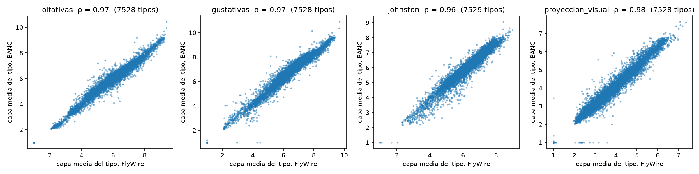
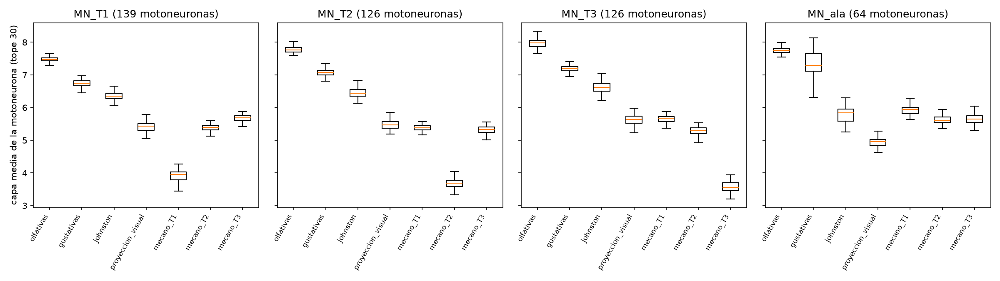
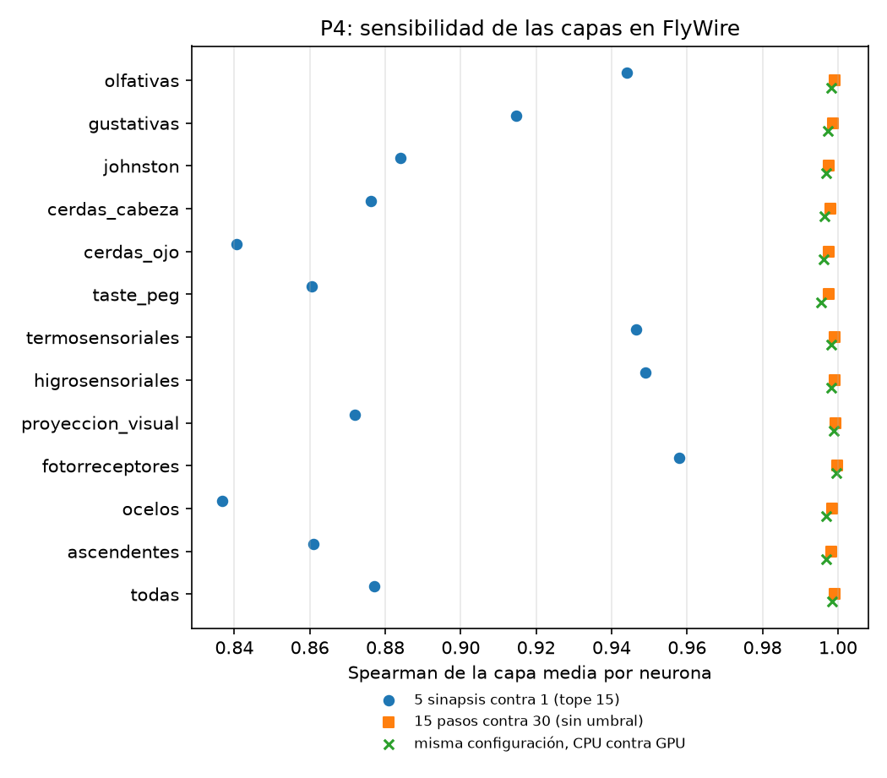

# fly-sensory-layers

How many synaptic steps does it take for each sensory modality to reach each neuron of the fruit fly brain, and its motor neurons? This repository measures that with the probabilistic traversal model of Schlegel et al. (2021) on public connectomes: the FlyWire whole brain (v783) and the brain-and-nerve-cord connectome BANC (v888).

**Status — v0.2 (Nov 2026).**

1. **Replication (v0.1).** An independent, vectorized implementation reproduces the published information-flow layers of Dorkenwald et al. (2024) for all 13 seed sets (Spearman ρ = 0.971–0.996).
2. **A second fly.** Brain layers per cell type agree between FlyWire and the BANC (ρ = 0.964–0.978).
3. **Legs.** In the full central nervous system, each leg's mechanosensory neurons reach that leg's motor neurons 1.5–2.1 steps sooner than the closest head modality, about 3 steps beyond what 10 degree-preserving random graphs give. The pre-registered threshold (≥ 2 steps in all three legs) is met only by the hind leg, so the hypothesis is **not** confirmed as stated.
4. **Sensitivity.** The 5-synapse threshold changes the layers (ρ ≈ 0.88); the step cap (15 vs. 30) does not.

**Full report** (Spanish, 10 pages): [`reporte/informe-final.pdf`](reporte/informe-final.pdf), with its LaTeX source.


## 1. Replication of the published layers (FlyWire v783)

| Seed modality | Spearman ρ | Mean \|Δ layer\| |
|---|---|---|
| Olfactory | 0.991 | 0.07 |
| Gustatory | 0.983 | 0.15 |
| Johnston's organ | 0.974 | 0.10 |
| Head bristles | 0.973 | 0.08 |
| Eye bristles | 0.974 | 0.08 |
| Taste peg (mechanosensory) | 0.971 | 0.10 |
| Thermosensory | 0.990 | 0.08 |
| Hygrosensory | 0.990 | 0.08 |
| Visual projection neurons | 0.993 | 0.07 |
| Photoreceptors | 0.996 | 0.06 |
| Ocellar | 0.980 | 0.09 |
| Ascending neurons | 0.981 | 0.07 |
| All inputs | 0.991 | 0.05 |

Compared against the published mean layers (Zenodo 12588557, 10,000 runs per modality), seeds excluded; 1,000 runs per modality here. Full table: [`resultados/03_validacion_publicado_completo_p15_u1.csv`](resultados/03_validacion_publicado_completo_p15_u1.csv).

**What it took to match.** The published methods describe the analysis on the central brain with a 5-synapse threshold. The published layers, however, are reproduced only with the **whole brain, all connections (no synapse threshold, 15.1 M neuron pairs) and a 15-step cap** (navis' default):

| Graph used | Spearman ρ vs. published |
|---|---|
| Central brain, ≥5 synapses, 30 steps | 0.65 – 0.95 |
| Whole brain, ≥5 synapses, 15 steps | 0.82 – 0.95 (layers systematically later) |
| **Whole brain, no threshold, 15 steps** | **0.971 – 0.996** |

**Sanity checks** (`02_resumen.py`): olfactory receptor neurons reach the olfactory Kenyon cells first, and visual projection neurons reach the visual Kenyon cells (KCg-d, KCab-p) first, as reported; gustatory and taste-peg inputs reach the brain's motor and endocrine neurons within a few steps.

## 2. Brain and nerve cord (BANC v888)

The criteria for this part were written down on 20 Nov 2026, **before opening the BANC data**, and were not changed afterwards:

- **H2 (same layers in a second fly).** Brain only, 15-step cap. Cell types matched to FlyWire through `fafb_cell_type`; Spearman of the mean layer per type for each head modality. Met if the median ρ ≥ 0.7 and at least 3 of 4 modalities reach 0.7.
- **H3 (leg shortcut).** Whole central nervous system, 30-step cap (15 also reported). A leg has a shortcut if the median layer of its own mechanosensory neurons at its motor neurons is at least **2 steps** lower than from the closest head modality, with a bootstrap 95 % interval (over motor neurons) that excludes 0. H3 holds if all three legs pass.
- **Control.** A shortcut counts only if the difference is larger than in all of 10 random graphs that keep every neuron's in- and out-degree.

Same model and code as in FlyWire, no synapse threshold, input fractions computed inside each subgraph, 1,000 runs per modality. Glia, non-neurons and unclassified rows removed: 122,575 neurons / 7.72 M pairs for the brain (H2) and 146,769 neurons / 10.65 M pairs for the whole CNS (H3).

**H2 holds.** 7,528 matched cell types:

| Head modality | ρ, all types | ρ, types with ≥5 neurons (1,507) |
|---|---|---|
| Olfactory | 0.972 | 0.984 |
| Gustatory | 0.971 | 0.975 |
| Johnston's organ | 0.964 | 0.972 |
| Visual projection | 0.978 | 0.985 |



**H3: median layer at the motor neurons** (whole CNS, 30-step cap; identical with 15):

| From | Front-leg MNs (T1) | Middle-leg MNs (T2) | Hind-leg MNs (T3) | Wing MNs |
|---|---|---|---|---|
| Front-leg mechanosensory | **3.95** | 5.38 | 5.67 | 5.94 |
| Middle-leg mechanosensory | 5.40 | **3.68** | 5.30 | 5.61 |
| Hind-leg mechanosensory | 5.69 | 5.34 | **3.56** | 5.65 |
| Visual projection | 5.43 | 5.47 | 5.64 | 4.96 |
| Johnston's organ | 6.35 | 6.44 | 6.62 | 5.84 |
| Gustatory | 6.74 | 7.08 | 7.19 | 7.30 |
| Olfactory | 7.47 | 7.76 | 7.97 | 7.75 |

**Shortcut vs. chance.** Difference = layer from the closest head modality (visual projection, in all three legs) − layer from the leg's own mechanosensory neurons:

| Leg | Real connectome (95 % CI) | 10 random graphs (range) | Larger than all 10? | Shortcut by the criterion? |
|---|---|---|---|---|
| T1 | 1.48 (1.42–1.53) | −1.55 to −1.49 | yes | no (< 2 steps) |
| T2 | 1.79 (1.74–1.84) | −1.26 to −1.22 | yes | no (< 2 steps) |
| T3 | 2.08 (2.00–2.12) | −1.34 to −1.30 | yes | **yes** |

In the random graphs (51.6 M edge swaps each, all 10.65 M pairs kept) the sign flips: the leg's own sensors end up 1.2–1.5 steps *farther* from its motor neurons than visual projection neurons. So each leg's proximity to its own motor neurons is real wiring, about 3 steps beyond what the degree distribution explains, but only the hind leg reaches the size fixed in advance. **Verdict: H3 is not met as stated.**



Not done on purpose: comparing these layers with the BANC paper's influence scores, which Bates et al. (2026) already did.

## 3. Sensitivity (FlyWire)

Spearman of the mean layer per neuron between pairs of runs, 12 modalities, seeds excluded. All three runs on the GPU with the same stopping rule; the "noise" row compares the same configuration run twice (CPU vs. GPU).

| Comparison | Median ρ | Range | Layer shift |
|---|---|---|---|
| Synapse threshold: 5 vs. 1 (15 steps) | 0.880 | 0.837–0.958 | without threshold, 0.07–1.25 steps earlier; ~12 k more neurons reached per modality |
| Step cap: 15 vs. 30 (no threshold) | 0.9985 | 0.9975–0.9998 | ≤ 0.02 steps; no new neurons |
| Noise: same configuration, CPU vs. GPU | 0.9971 | 0.9955–0.9997 | ≤ 0.017 steps |

The step cap is within noise; the threshold is not. Weak connections (< 5 synapses) carry part of the flow, which is why the published layers are reproduced only without a threshold. Worth keeping in mind when comparing traversal layers across datasets.



## The model

Seed neurons are layer 1. At every step, each edge *i → j* from an already-traversed neuron *i* to a not-yet-traversed neuron *j* succeeds independently with probability

p<sub>ij</sub> = min(1, A<sub>ij</sub> / 0.3),  A<sub>ij</sub> = W<sub>ij</sub> / Σ<sub>k</sub> W<sub>kj</sub>

where *W* is the synapse count and *A* the fraction of *j*'s inputs coming from *i*. Neuron *j* is traversed if any of its edges succeeds; its layer is that step. Neurons that fail are retried at later steps. A run stops when no candidate edges remain (or at the step cap). Layers are averaged over runs.

This is exactly what `navis.models.TraversalModel` does (edge-wise draws, retries). Instead of drawing per edge, `02_recorrido.py` draws once per neuron with P<sub>j</sub> = 1 − Π<sub>i</sub>(1 − p<sub>ij</sub>), which has the same distribution and turns each step into one sparse matrix product over a batch of runs. Against navis on a 1,610-neuron subgraph, non-seed layers differ by ~0.001 on average (`02_validar_navis.py`). One difference found on the way: navis silently drops seeds that have no outgoing edges.

**GPU (optional).** `recorrido_gpu.py` runs the same model with CuPy: runs are the columns of a dense matrix and each step is a cuSPARSE sparse × dense product. Same stopping rule as the CPU. Validated against the CPU on the same graphs: r ≥ 0.999 per neuron in FlyWire (bias ≤ 0.017 steps, same neurons reached) and r ≥ 0.994 on a BANC random graph, with the H3 measure equal to two decimals. On an RTX 5050 laptop GPU a full FlyWire run (13 modalities, run until convergence) takes 2–16 min, against 18–35 min on 10–13 CPU processes with fewer runs per modality.

## Reproduce

Requires [uv](https://docs.astral.sh/uv/) (every script declares its own dependencies). Code comments and messages are in Spanish.

```bash
uv run 00_descargar.py        # FlyWire (Zenodo), annotations (GitHub), published layers and BANC (Harvard Dataverse); MD5-checked
uv run 01_grados.py           # degree distribution; checks 2,700,513 connections / 34,153,566 synapses
uv run pruebas_recorrido.py   # 9 tests on synthetic graphs
uv run 02_validar_navis.py    # comparison with navis on a subgraph

# 1. replication
uv run 02_recorrido.py --alcance completo --umbral-sinapsis 1 --max-pasos 15 --max-corridas 1000
uv run 03_validar_publicado.py _completo_p15_u1
uv run 03_figuras_cerebro.py   _completo_p15_u1

# 2. BANC
uv run 04_banc.py --h2        # brain only, 15 steps
uv run 04_banc.py --h3        # whole CNS, 30 steps (15 reported too)
uv run 04_azar_lote.py        # the 10 random graphs (add --gpu to use the GPU)
uv run 05_evaluar_banc.py     # H2 and H3 against the criteria above

# 3. sensitivity (GPU runs, same stopping rule)
python 02_recorrido.py --alcance completo --umbral-sinapsis 1 --max-pasos 30 --gpu --etiqueta _gpu
python 02_recorrido.py --alcance completo --umbral-sinapsis 1 --max-pasos 15 --gpu --etiqueta _gpu
python 02_recorrido.py --alcance completo --max-pasos 15 --gpu --etiqueta _gpu
uv run 06_sensibilidad.py
```

The `--gpu` runs need a Python environment with CuPy for CUDA 12 (e.g. `pip install cupy-cuda12x numpy scipy pandas pyarrow`); `04_azar_lote.py --gpu` takes it from `--python-gpu` or the `FLY_GPU_PYTHON` variable. Everything also runs on the CPU without `--gpu`, only slower (a BANC random graph: ~31 min on 4 processes vs. ~6 min on the GPU).

| File | What it does |
|---|---|
| `00_descargar.py` | Downloads FlyWire connections (Zenodo 10676866), annotations (Schlegel et al. 2024), published layers (Zenodo 12588557) and the BANC (doi:10.7910/DVN/7WTH1N) |
| `01_grados.py` | Loads the connectome as a sparse matrix; degree distribution |
| `02_recorrido.py` | Traversal model on FlyWire; 12 sensory modalities + all inputs, in parallel or on the GPU |
| `recorrido_gpu.py` | The same model on the GPU (CuPy) |
| `02_validar_navis.py` | Same subgraph through both implementations |
| `02_resumen.py` | Layer counts, superclass percentiles, Kenyon-cell check |
| `03_validar_publicado.py` | Comparison with the published layers |
| `03_figuras_cerebro.py` | Superclass and descending-neuron figures, own vs. published |
| `04_banc.py` | The model on the BANC: brain (H2), whole CNS (H3) and degree-preserving random graphs |
| `04_azar_lote.py` | Runs the 10 random graphs one after another |
| `05_evaluar_banc.py` | H2 and H3 against the pre-registered criteria, with bootstrap and the random-graph control |
| `06_sensibilidad.py` | Synapse-threshold and step-cap sensitivity |
| `pruebas_recorrido.py`, `propiedades_recorrido.py` | Tests and property-based tests |

## Open questions

- About 15–17 k neurons get a layer here but are absent from the published table; it does not affect the comparison (only neurons present in both are compared), but the reason is unknown.
- Whether the leg shortcut holds in another fly once a second brain-and-cord connectome is available.

## Data, licenses and citations

The data are not redistributed here; `00_descargar.py` fetches them from the source. FlyWire connectivity and annotations are CC BY-NC 4.0; the published information-flow layers and the BANC v888 release are CC BY 4.0. Code: MIT.

- Schlegel, P. et al. (2021). Information flow, cell types and stereotypy in a full olfactory connectome. *eLife* 10, e66018.
- Dorkenwald, S. et al. (2024). Neuronal wiring diagram of an adult brain. *Nature* 634, 124–138.
- Schlegel, P. et al. (2024). Whole-brain annotation and multi-connectome cell typing of *Drosophila*. *Nature* 634, 139–152.
- Lin, A., Yang, R. et al. (2024). Network statistics of the whole-brain connectome of *Drosophila*. *Nature* 634, 153–165.
- Bates, A. S. et al. (2026). Distributed control circuits across a brain-and-cord connectome. *Nature*.
- FlyWire Codex: https://codex.flywire.ai

Author: Atlahua Quiahuitl Martínez Obregón — Computer Engineering, UAM Azcapotzalco (Mexico City).
