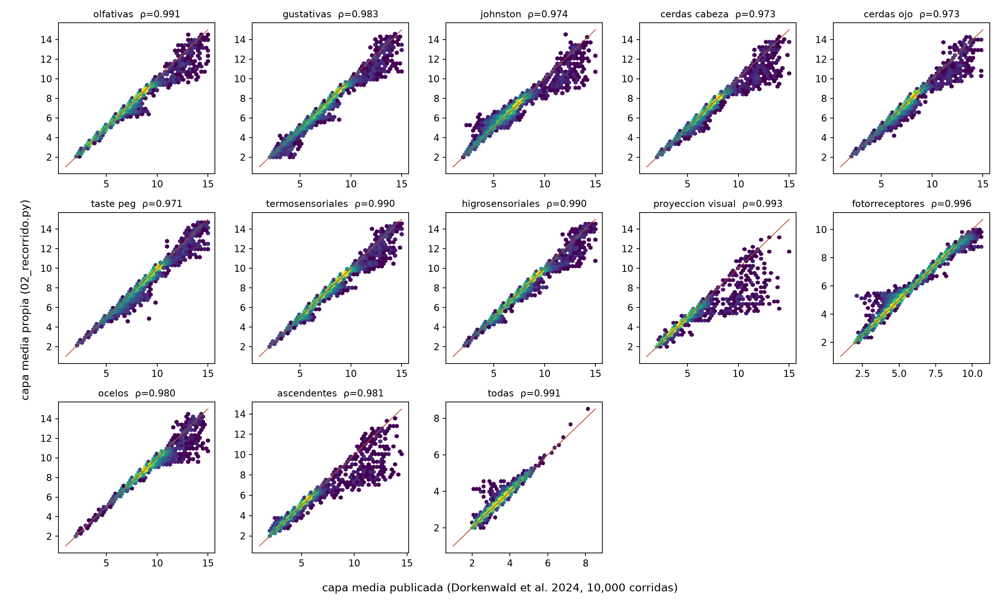

# fly-sensory-layers

How many synaptic steps does it take for each sensory modality to reach each neuron of the fruit fly brain, and, later, its motor neurons? This repository measures that with the probabilistic traversal model of Schlegel et al. (2021) on public connectomes: first the FlyWire whole brain (v783), then the brain-and-nerve-cord BANC.

**Status — v0.1 (Nov 2026): replication.** An independent, vectorized implementation of the traversal model reproduces the published information-flow layers of Dorkenwald et al. (2024) for all 13 seed sets (Spearman ρ = 0.971–0.996). Extending the analysis through the ventral nerve cord (BANC) is the next step.



## Results so far

| Seed modality | Spearman ρ | Mean \|Δ layer\| |
|---|---|---|
| Olfactory | 0.991 | 0.07 |
| Gustatory | 0.983 | 0.15 |
| Johnston's organ | 0.974 | 0.10 |
| Head bristles | 0.973 | 0.08 |
| Eye bristles | 0.974 | 0.08 |
| Taste peg (mechanosensory) | 0.971 | 0.10 |
| Thermosensory | 0.990 | 0.08 |
| Hygrosensory | 0.990 | 0.08 |
| Visual projection neurons | 0.993 | 0.07 |
| Photoreceptors | 0.996 | 0.06 |
| Ocellar | 0.980 | 0.09 |
| Ascending neurons | 0.981 | 0.07 |
| All inputs | 0.991 | 0.05 |

Compared against the published mean layers (Zenodo 12588557, 10,000 runs per modality), seeds excluded; 1,000 runs per modality here. Full table: [`resultados/03_validacion_publicado_completo_p15_u1.csv`](resultados/03_validacion_publicado_completo_p15_u1.csv).

**What it took to match.** The published methods describe the analysis on the central brain with a 5-synapse threshold. The published layers, however, are reproduced only with the **whole brain, all connections (no synapse threshold, 15.1 M neuron pairs) and a 15-step cap** (navis' default):

| Graph used | Spearman ρ vs. published |
|---|---|
| Central brain, ≥5 synapses, 30 steps | 0.65 – 0.95 |
| Whole brain, ≥5 synapses, 15 steps | 0.82 – 0.95 (layers systematically later) |
| **Whole brain, no threshold, 15 steps** | **0.971 – 0.996** |

So the synapse threshold alone changes the layer ordering noticeably. That is worth keeping in mind when comparing traversal layers across datasets.

**Sanity checks** (`02_resumen.py`): olfactory receptor neurons reach the olfactory Kenyon cells first, and visual projection neurons reach the visual Kenyon cells (KCg-d, KCab-p) first, as reported; gustatory and taste-peg inputs reach the brain's motor and endocrine neurons within a few steps.

## The model

Seed neurons are layer 1. At every step, each edge *i → j* from an already-traversed neuron *i* to a not-yet-traversed neuron *j* succeeds independently with probability

p<sub>ij</sub> = min(1, A<sub>ij</sub> / 0.3),  A<sub>ij</sub> = W<sub>ij</sub> / Σ<sub>k</sub> W<sub>kj</sub>

where *W* is the synapse count and *A* the fraction of *j*'s inputs coming from *i*. Neuron *j* is traversed if any of its edges succeeds; its layer is that step. Neurons that fail are retried at later steps. A run stops when no candidate edges remain (or at the step cap). Layers are averaged over runs.

This is exactly what `navis.models.TraversalModel` does (edge-wise draws, retries). Instead of drawing per edge, `02_recorrido.py` draws once per neuron with P<sub>j</sub> = 1 − Π<sub>i</sub>(1 − p<sub>ij</sub>), which has the same distribution and turns each step into one sparse matrix product over a batch of 100 runs. Against navis on a 1,610-neuron subgraph, non-seed layers differ by ~0.001 on average (`02_validar_navis.py`). One difference found on the way: navis silently drops seeds that have no outgoing edges.

## Reproduce

Requires [uv](https://docs.astral.sh/uv/) (every script declares its own dependencies). Code comments and messages are in Spanish.

```bash
uv run 00_descargar.py        # ~860 MB from Zenodo and GitHub, MD5-checked (parallel range requests)
uv run 01_grados.py           # degree distribution; checks 2,700,513 connections / 34,153,566 synapses
uv run pruebas_recorrido.py   # 9 tests on synthetic graphs
uv run 02_validar_navis.py    # comparison with navis on a subgraph
uv run 02_recorrido.py --alcance completo --umbral-sinapsis 1 --max-pasos 15 --max-corridas 1000
uv run 03_validar_publicado.py _completo_p15_u1
uv run 03_figuras_cerebro.py   _completo_p15_u1
```

The replication run took ~35 min on a 16-thread laptop (10 processes, 15.1 M edges).

| File | What it does |
|---|---|
| `00_descargar.py` | Downloads connections (Zenodo 10676866), annotations (Schlegel et al. 2024) and published layers (Zenodo 12588557) |
| `01_grados.py` | Loads the connectome as a sparse matrix; degree distribution |
| `02_recorrido.py` | Traversal model; 12 sensory modalities + all inputs, in parallel |
| `02_validar_navis.py` | Same subgraph through both implementations |
| `02_resumen.py` | Layer counts, superclass percentiles, Kenyon-cell check |
| `03_validar_publicado.py` | Comparison with the published layers |
| `03_figuras_cerebro.py` | Superclass and descending-neuron figures, own vs. published |
| `pruebas_recorrido.py` | Tests |

## Next

1. Run the same model on the BANC (brain + ventral nerve cord, Bates et al. 2026) down to leg and wing motor neurons.
2. Compare brain layers between two individual flies (FlyWire vs. the brain part of the BANC), matched by cell type.
3. Sensitivity of the layers to the synapse threshold and the step cap.

## Data, licenses and citations

The data are not redistributed here; `00_descargar.py` fetches them from the source. FlyWire connectivity and annotations are CC BY-NC 4.0; the published information-flow layers are CC BY 4.0. Code: MIT.

- Schlegel, P. et al. (2021). Information flow, cell types and stereotypy in a full olfactory connectome. *eLife* 10, e66018.
- Dorkenwald, S. et al. (2024). Neuronal wiring diagram of an adult brain. *Nature* 634, 124–138.
- Schlegel, P. et al. (2024). Whole-brain annotation and multi-connectome cell typing of *Drosophila*. *Nature* 634, 139–152.
- Lin, A., Yang, R. et al. (2024). Network statistics of the whole-brain connectome of *Drosophila*. *Nature* 634, 153–165.
- Bates, A. S. et al. (2026). Distributed control circuits across a brain-and-cord connectome. *Nature*.
- FlyWire Codex: https://codex.flywire.ai

Author: Atlahua Quiahuitl Martínez Obregón — Computer Engineering, UAM Azcapotzalco (Mexico City).
